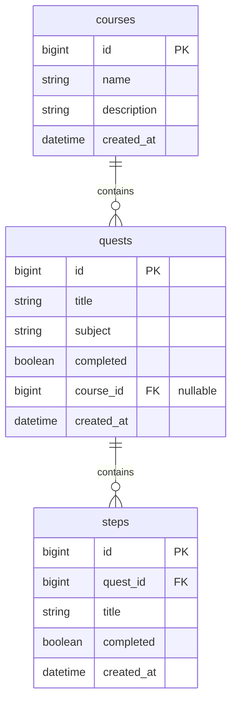

# Study Quest REST API

Base URL: `http://localhost:8080`. Paths have no trailing slash. No authentication
is required for this local coursework application. Send request bodies with
`Content-Type: application/json`. Maximum body size: 8192 bytes.

## Data models

SQLAlchemy defines the tables and issues parameterized SQL. Docker uses
PostgreSQL 17; a local launch without database settings uses persistent SQLite.



Both relationships are one-to-many. Each step must reference a quest. A quest
may reference one course or have `course_id: null` for standalone study goals.
The database enforces foreign keys and restricts parent deletion. Reassign a
child or delete it before deleting its parent. Completion flags do not propagate.

| Model | Writable fields | Required on POST | Defaults |
| --- | --- | --- | --- |
| Course | `name`: nonblank string, 1–120 characters; `description`: string, 0–1000 characters | `name` | `description: ""` |
| Quest | `title`: nonblank string, 1–120; `subject`: nonblank string, 1–60; `completed`: boolean; `course_id`: existing course ID or null | `title`, `subject` | `completed: false`, `course_id: null` |
| Step | `title`: nonblank string, 1–120; `completed`: boolean; `quest_id`: existing quest ID | `title`, `quest_id` | `completed: false` |

Text is trimmed before storage. All models also return server-generated `id`
and `created_at`; clients cannot set or change them. IDs must be positive signed
64-bit integers (`1..9223372036854775807`). Reference fields accept JSON numbers,
not numeric strings or booleans. `completed` accepts only JSON `true` or `false`.

## Response schemas

The following examples show the complete fields for individual resources:

```json
{"id":1,"name":"Web Development","description":"Backend course","created_at":"2026-11-13T10:00:00+00:00"}
```

```json
{"id":2,"title":"Build REST API","subject":"Backend","completed":false,"course_id":1,"created_at":"2026-11-13T10:00:00+00:00"}
```

```json
{"id":3,"quest_id":2,"title":"Document endpoints","completed":false,"created_at":"2026-11-13T10:00:00+00:00"}
```

Timestamps are ISO 8601 UTC strings. List responses wrap arrays in the resource
name, for example `{"quests":[...]}`. Empty lists return `200` with `[]` inside
the envelope. Lists are ordered by descending ID. No pagination or query
parameters are supported; resource endpoints reject query parameters with `400`.

## Endpoints

`{id}` is the ID of the named resource. Related paths use the parent ID.
`Course`, `Quest`, and `Step` below refer to the complete schemas above.
POST returns the new resource and a `Location: /api/{resource}/{id}` header.
PATCH updates only supplied fields and requires at least one writable field.
DELETE returns the deleted resource as JSON with status `200`.

| Method | URL | Parameters / body | Expected success response |
| --- | --- | --- | --- |
| GET | `/api/courses` | None | `200 {"courses":[Course,...]}` |
| POST | `/api/courses` | `{"name":"Web","description":"Backend course"}`; description optional | `201 Course` |
| GET | `/api/courses/{id}` | Course ID | `200 Course` |
| PATCH | `/api/courses/{id}` | Course ID; any subset of `name`, `description`, e.g. `{"name":"REST"}` | `200 updated Course` |
| DELETE | `/api/courses/{id}` | Course ID | `200 deleted Course` |
| GET | `/api/quests` | None | `200 {"quests":[Quest,...]}` |
| POST | `/api/quests` | `{"title":"Build API","subject":"Web","course_id":1,"completed":false}`; course_id/completed optional | `201 Quest` |
| GET | `/api/quests/{id}` | Quest ID | `200 Quest` |
| PATCH | `/api/quests/{id}` | Quest ID; any subset of `title`, `subject`, `completed`, `course_id`, e.g. `{"completed":true}` | `200 updated Quest` |
| DELETE | `/api/quests/{id}` | Quest ID | `200 deleted Quest` |
| GET | `/api/steps` | None | `200 {"steps":[Step,...]}` |
| POST | `/api/steps` | `{"quest_id":2,"title":"Test API","completed":false}`; completed optional | `201 Step` |
| GET | `/api/steps/{id}` | Step ID | `200 Step` |
| PATCH | `/api/steps/{id}` | Step ID; any subset of `title`, `completed`, `quest_id`, e.g. `{"completed":true}` | `200 updated Step` |
| DELETE | `/api/steps/{id}` | Step ID | `200 deleted Step` |
| GET | `/api/courses/{id}/quests` | Course ID | `200 {"quests":[Quest,...]}` restricted to this course |
| POST | `/api/courses/{id}/quests` | Course ID; `{"title":"Build API","subject":"Web"}`; completed optional; omit course_id | `201 Quest` linked to the course |
| GET | `/api/quests/{id}/steps` | Quest ID | `200 {"steps":[Step,...]}` restricted to this quest |
| POST | `/api/quests/{id}/steps` | Quest ID; `{"title":"Test API"}`; completed optional; omit quest_id | `201 Step` linked to the quest |
| GET | `/health` | None | `200 {"status":"healthy","database":"connected"}` after a real DB query |
| GET | `/api/info` | None | `200 {"app":"Study Quest","message":"...","hostname":"..."}` from environment/server |
| GET | `/Test` | None | `200 {"title":"New page","message":"I get it"}`; retained demo route |
| GET | `/` | None | `200 text/html` existing study-goal page |

There are 19 domain operations and 3 supporting JSON operations, plus the HTML
page. Related GET/POST requests return `404` when the parent is absent. An
existing parent without children returns an empty array for related GET.

## Error responses

Errors use `application/json` with a nonempty `error` string:

```json
{"error":"Remove or reassign dependent records before deleting this record"}
```

| Status | Conditions |
| --- | --- |
| `400 Bad Request` | Missing required fields; invalid types, lengths, or IDs; blank required text; malformed JSON; non-object body; wrong content type; unknown/read-only fields; empty PATCH; missing reference on standalone create/update; reference field supplied in a nested POST; unsupported query parameters |
| `404 Not Found` | Unknown URL, absent resource, or absent related parent |
| `405 Method Not Allowed` | Unsupported method on a registered URL; includes `Allow` header |
| `409 Conflict` | Parent still has children, or a concurrent write violates a relationship constraint |
| `413 Request Entity Too Large` | Request body exceeds 8192 bytes |
| `503 Service Unavailable` | Database connection or query failure; connection details are not returned |

Validation occurs before database operations, so an invalid PATCH body may
return `400` before checking whether its target exists. Creation defaults apply
only to POST; PATCH preserves omitted fields and the original timestamp.

## Postman

Import `postman/StudyQuest.postman_collection.json` and the matching local
environment. Select **Study Quest - Local** and run all requests in order.
The collection sets IDs automatically, covers every JSON operation, checks
relationships and error responses, and deletes only the records it creates.
The collection and Python integration suite also check the HTML page.

```powershell
npx --yes newman run postman/StudyQuest.postman_collection.json -e postman/StudyQuest.local.postman_environment.json
```

To rebuild the collection after editing its source:

```powershell
python postman/build_study_collection.py
```
