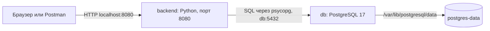

# Защита Study Quest

Материал сверён с `app.py`, `index.html`, `Dockerfile`, `compose.yaml` и коллекцией Postman 28 октября 2026 года. Команды выполняются в PowerShell из папки `Webproject`, где лежит `compose.yaml`.

## 1. Что сказать в начале защиты

> Мой проект Study Quest — трекер учебных задач. Пользователь создаёт задачу с названием и предметом, просматривает задачи и отмечает выполнение. API также позволяет получить задачу по ID и удалить её. Приложение состоит из двух сервисов Docker Compose: Python backend и PostgreSQL. Backend отдаёт HTML-страницу и JSON API, а через библиотеку psycopg выполняет SQL-запросы. Сервисы общаются по имени `db` внутри Docker-сети. Данные PostgreSQL находятся в named volume, поэтому сохраняются при пересоздании контейнеров. Все маршруты можно показать в Postman.

Не называй backend Flask или Django: здесь стандартный модуль Python `http.server`. Не обещай редактирование названия и предмета: PATCH изменяет только `completed`. Кнопки удаления в браузере нет, но DELETE доступен через API.

## 2. Архитектура и путь запроса



`backend` и `db` подключены к bridge-сети `app-network`. При обычном запуске Compose добавляет имя проекта к ресурсам: `study-quest_app-network`, `study-quest_postgres-data`. Переопределение имени проекта изменит префикс.

Пример создания задачи:

1. Браузер вызывает `fetch('/api/quests', ...)`, Postman отправляет такой же HTTP POST.
2. Хостовый порт 8080 направляет запрос в порт 8080 контейнера backend.
3. `do_POST()` вызывает `handle_api('POST')` в `app.py`.
4. `read_json()` проверяет Content-Type, размер и JSON-объект.
5. Backend проверяет строки `title` и `subject`, удаляет пробелы по краям.
6. `connect()` открывает соединение с PostgreSQL по `db:5432`.
7. `INSERT ... RETURNING *` создаёт запись и возвращает её поля.
8. При успешном выходе из `with connect() as db` транзакция фиксируется, соединение закрывается.
9. `send_json(201, quest)` возвращает созданную задачу клиенту.
10. Браузер заново получает список через GET и обновляет DOM.

Postman не подключается к PostgreSQL напрямую. Пароль БД нужен backend, а не HTTP-клиенту. Отдельный frontend-контейнер не требуется: страницу отдаёт тот же backend. Браузер использует относительные URL и тот же origin.

## 3. Теоретические вопросы о Docker

### Что такое Docker, image и container?

Docker предоставляет инструменты для сборки образов и запуска изолированных процессов в контейнерах. Образ содержит файловую систему приложения: Python, библиотеки, код и настройки по умолчанию. Контейнер — экземпляр образа с собственными процессами, сетевым окружением и записываемым слоем.

Образ неизменяемый: при изменении кода собирают новый образ. Из одного образа можно создать несколько контейнеров. Остановка контейнера сохраняет его записываемый слой, удаление контейнера удаляет этот слой. Поэтому данные БД вынесены в volume.

Контейнер обычно легче виртуальной машины: Linux-контейнеры используют общее Linux-ядро. На Windows Docker Desktop запускает их через Linux-среду, например WSL2; отдельная полноценная ОС внутри каждого контейнера не устанавливается.

В проекте backend собирается из `Dockerfile`, а БД использует готовый `postgres:17-alpine`. Тег — имя версии образа; для строгой воспроизводимости образ дополнительно можно закрепить digest. Здесь базовые образы закреплены тегами, а psycopg — точной версией `3.3.6`.

### Что такое Dockerfile и build context?

Dockerfile — рецепт сборки образа. `build: .` в Compose задаёт текущую папку как build context. `COPY` берёт файлы из этого контекста. `.dockerignore` исключает ненужные файлы до передачи контекста сборщику, в том числе `.env`.

Инструкции сборки создают изменения файловой системы и метаданные образа; Docker переиспользует подходящий кеш. Поэтому зависимости копируются и устанавливаются до кода: изменение `app.py` обычно не требует повторной установки psycopg.

### Чем RUN отличается от CMD?

`RUN` выполняется во время сборки, например устанавливает зависимости. `CMD` задаёт команду запуска контейнера: `python app.py`. При обычном старте готового образа `RUN pip install ...` повторно не выполняется.

### Для чего нужен Compose?

Compose описывает многоконтейнерное приложение в YAML: сервисы, сборку, переменные, порты, зависимости, сети и тома. `docker compose up` создаёт необходимые ресурсы и запускает сервисы. В проекте один сервис приложения и один сервис базы данных.

### Как работают networks и имя db?

В общей Docker-сети сервисы находят друг друга по имени через встроенный DNS. Поэтому backend использует `DB_HOST=db`, а не меняющийся IP контейнера.

`localhost` внутри backend означает сам backend. Адрес `localhost:5432` там не указывает на отдельный контейнер PostgreSQL. Для связи backend → db публикация порта БД на Windows не нужна.

### Что означают порты 8080:8080 и EXPOSE?

В `"${APP_PORT:-8080}:8080"` слева порт хоста, справа порт контейнера. Можно поставить `APP_PORT=8081`: Postman будет обращаться к `localhost:8081`, а Python продолжит слушать 8080 внутри контейнера.

`EXPOSE 8080` документирует порт образа. Публикацию на хост выполняет `ports` в Compose. `HOST=0.0.0.0` заставляет Python принимать соединения на всех интерфейсах контейнера; слушать только `127.0.0.1` было бы недостаточно для обычного проброса порта.

У `db` нет секции `ports`: порт PostgreSQL не опубликован на хост. Сеть не объявлена `internal: true`, поэтому не называй её полностью изолированной от внешнего мира.

### Что такое volume? Чем отличается от bind mount?

Named volume — хранилище, которым управляет Docker. Здесь `postgres-data` смонтирован в `/var/lib/postgresql/data`, куда PostgreSQL записывает свои файлы. Bind mount связывает конкретный путь хоста с путём контейнера. В проекте для БД применяется named volume.

Volume переживает удаление контейнера. `docker compose down` сохраняет этот том; `docker compose down -v` удаляет том и данные. Сам volume не является резервной копией. На Docker Desktop Linux-данные находятся в хранилище Linux-среды; это не папка с SQL-файлами рядом с проектом.

### Как работают environment variables и .env?

`.env` — источник значений для подстановок Compose. Он не попадает в окружение контейнера автоматически целиком. Секция `environment` явно передаёт нужные значения процессу контейнера; Python читает их через `os.environ` и `os.getenv`.

| Значение | Где используется |
| --- | --- |
| `APP_PORT` | Compose: опубликованный порт хоста |
| `PORT=8080`, `HOST=0.0.0.0` | Backend: адрес прослушивания внутри контейнера |
| `APP_NAME`, `APP_MESSAGE` | `/api/info`, затем заголовок и текст страницы |
| `POSTGRES_DB`, `POSTGRES_USER`, `POSTGRES_PASSWORD` | Инициализация PostgreSQL на пустом хранилище |
| `DB_NAME`, `DB_USER`, `DB_PASSWORD` | Те же значения передаются backend под другими именами |
| `DB_HOST=db`, `DB_PORT=5432` | Внутренний адрес PostgreSQL |

`${APP_PORT:-8080}` означает значение по умолчанию при пустой или отсутствующей переменной. `${POSTGRES_DB:?Set ...}` останавливает Compose, если обязательная переменная отсутствует или пуста. Переменная текущего shell может перекрыть значение `.env`.

`$$POSTGRES_USER` в healthcheck экранирует доллар для Compose: переменную развернёт shell внутри контейнера БД.

После изменения `.env` простой `docker compose restart` не обновит окружение уже созданного контейнера. Нужен `docker compose up -d --force-recreate --wait`. Изменение `POSTGRES_PASSWORD` при существующем volume не меняет пароль существующего пользователя PostgreSQL.

Официальные основания: [образы](https://docs.docker.com/get-started/docker-concepts/the-basics/what-is-an-image/), [сети Compose](https://docs.docker.com/compose/how-tos/networking/), [подстановка переменных](https://docs.docker.com/compose/how-tos/environment-variables/variable-interpolation/), [volumes](https://docs.docker.com/engine/storage/volumes/).

## 4. Как объяснить Dockerfile по порядку

| Инструкция | Что сказать |
| --- | --- |
| `FROM python:3.12-slim` | Базовый образ с Python 3.12 и небольшой Debian-системой |
| `ENV ...` | Значения по умолчанию; `PYTHONUNBUFFERED=1` помогает сразу видеть логи, `PYTHONDONTWRITEBYTECODE=1` отключает запись pyc |
| `WORKDIR /app` | Рабочая папка следующих инструкций и запуска приложения |
| `RUN addgroup ... adduser ...` | Создаёт отдельного системного пользователя приложения |
| `COPY requirements.txt ...` | Копирует описание зависимостей перед кодом ради кеша |
| `RUN pip install --no-cache-dir ...` | Устанавливает `psycopg[binary]==3.3.6`; pip-кеш не сохраняется |
| `COPY --chown=... app.py index.html ./` | Включает backend и страницу в образ, назначает владельца |
| `USER appuser` | Запускает приложение без root-привилегий |
| `EXPOSE 8080` | Документирует внутренний HTTP-порт |
| `HEALTHCHECK ...` | Периодически вызывает `/health`; HTTP-ошибка делает проверку неуспешной |
| `CMD ["python", "app.py"]` | Запускает Python в exec-форме без дополнительного shell |

Код копируется в образ, bind mount с исходниками не настроен. Поэтому правка файла на Windows требует пересборки: `docker compose up -d --build --wait`.

## 5. Как объяснить compose.yaml

`name: study-quest` задаёт имя проекта. `backend.build: .` собирает наш Dockerfile. `db.image` загружает готовый PostgreSQL. Оба сервиса подключены к одной сети. Только backend публикует порт хоста.

`depends_on` с `condition: service_healthy` ждёт успешного healthcheck БД перед запуском backend. Проверка `pg_isready` показывает готовность PostgreSQL принимать соединения; успешное выполнение SQL с настройками приложения дополнительно проверяет `/health`.

Backend при старте вызывает `initialize_database()`. Если БД недоступна, процесс завершится с сообщением `Database initialization failed; check configuration and readiness.`

`restart: unless-stopped` — политика перезапуска завершившегося контейнера. Сам по себе статус `unhealthy` не означает автоматический перезапуск. `depends_on` также не обеспечивает постоянный контроль или автоматическое восстановление всех зависимостей после старта.

## 6. Части исходного кода для объяснения

Номера строк относятся к версии на дату подготовки; имена функций позволяют найти участок после правок.

| Место | Объяснение |
| --- | --- |
| `app.py:13`, `connect()` | Читает настройки БД из окружения; `connect_timeout=3` ограничивает установку соединения, `statement_timeout=5000` — выполнение SQL; `dict_row` возвращает строки как словари |
| `app.py:22`, `initialize_database()` | Создаёт таблицу при отсутствии; повторный запуск не удаляет записи и не выполняет полноценную миграцию существующей схемы |
| `app.py:36`, `send_body()` | Устанавливает HTTP-статус, Content-Type, длину тела в байтах и отправляет ответ |
| `app.py:44`, `send_json()` | Превращает данные в UTF-8 JSON; `default=str` позволяет сериализовать timestamp |
| `app.py:48`, `read_json()` | Требует `application/json`, тело 1–8192 байта и JSON-объект |
| `app.py:59`, `handle_api()` | Выбирает обработку по HTTP-методу и пути; `urlsplit` отделяет путь от query string |
| `app.py:82`, POST | Проверяет title 1–120 и subject 1–60 символов после trim; выполняет INSERT |
| `app.py:98`, обработка ID | Разрешает положительное 64-битное целое из ASCII-цифр |
| `app.py:115`, PATCH | Выполняет UPDATE только поля completed; требует именно JSON boolean |
| `app.py:122`, исключения | Ошибки ввода дают 400; `psycopg.Error` даёт 503 без раскрытия реквизитов БД |
| `app.py:140`, `main()` | Проверяет порт, создаёт таблицу, запускает `ThreadingHTTPServer`, затем `serve_forever()` |
| `index.html:45`, `api()` | Обёртка над fetch; читает JSON и превращает HTTP-ошибку в исключение |
| `index.html:51`, `load()` | Загружает список, строит DOM и счётчик выполненных задач |
| `index.html:69`, checkbox | Посылает PATCH и обновляет список; при ошибке возвращает прежнее состояние |
| `index.html:91`, submit | Отменяет обычную отправку формы, посылает POST, очищает форму, обновляет список |

### Как устроена таблица quests?

`id` — BIGINT IDENTITY и PRIMARY KEY: PostgreSQL генерирует уникальный ID. `title` и `subject` — обязательные строки с ограничениями длины и CHECK против пустых значений. `completed` — BOOLEAN, по умолчанию false. `created_at` — TIMESTAMPTZ, по умолчанию время создания записи. После DELETE возможны пропуски ID, это нормально.

### Почему SQL использует %s?

```python
db.execute(
    'INSERT INTO quests (title, subject) VALUES (%s, %s) RETURNING *',
    (fields['title'], fields['subject']),
).fetchone()
```

SQL и значения передаются раздельно. Psycopg связывает параметры, поэтому пользовательская строка не превращается в SQL-код. Нельзя заменять этот участок f-строкой с пользовательскими данными. `RETURNING *` получает созданную запись без отдельного SELECT.

`with connect() as db` фиксирует транзакцию при нормальном выходе, откатывает при исключении и закрывает соединение. На операции открываются отдельные соединения; пула соединений в проекте нет.

### Зачем нужна проверка и в Python, и в PostgreSQL?

Python возвращает понятную ошибку 400 до выполнения SQL. Ограничения PostgreSQL дополнительно защищают данные при записи другими клиентами. В интерфейсе также есть required/maxlength, но клиентские проверки можно обойти через Postman.

### Какие ограничения проекта назвать честно?

Учебное приложение без авторизации: любой клиент с доступом к API может менять задачи. Нет пагинации, редактирования названия, миграций и пула БД. Стандартный `http.server` выбран ради простоты и не позиционируется как готовый production-стек. Пользовательские строки выводятся через `textContent`, поэтому не вставляются в страницу как HTML.

## 7. Демонстрация в Postman: 5–7 минут

### Подготовка

Запусти Docker Desktop в режиме Linux containers, затем:

```powershell
docker compose up -d --build --wait
docker compose ps
```

Ожидается работающий backend и db со статусом healthy. При чистом checkout сначала создай `.env` из `.env.example` и задай пароль. Существующий `.env` перезаписывать не нужно.

В Postman импортируй:

- `postman/StudyQuest.postman_collection.json`;
- `postman/StudyQuest.local.postman_environment.json`.

Выбери окружение `Study Quest - Local`: `baseUrl=http://localhost:8080`. Для другого опубликованного порта поменяй baseUrl. В Body выбирай raw → JSON. Авторизации нет.

### Порядок показа

| Действие в Postman | Ожидание и объяснение |
| --- | --- |
| `GET {{baseUrl}}/` | 200, HTML; backend отдаёт браузерную страницу |
| `GET {{baseUrl}}/health` | 200, healthy/connected; реально выполняется SELECT 1 |
| `GET {{baseUrl}}/api/info` | 200, имя, сообщение и hostname контейнера |
| `GET {{baseUrl}}/api/quests` | 200, объект с массивом quests |
| `POST {{baseUrl}}/api/quests` | 201, новая задача с id, completed=false и created_at |
| `GET {{baseUrl}}/api/quests/{{questId}}` | 200, именно созданная задача |
| `PATCH {{baseUrl}}/api/quests/{{questId}}` | 200, completed=true |
| Повторный GET по ID | 200, подтверждает чтение обновлённого значения из БД |
| `DELETE {{baseUrl}}/api/quests/{{questId}}` | 200, объект удалённой задачи |
| Повторный GET по ID | 404, Quest not found |

Тело POST:

```json
{"title":"Defend Docker project","subject":"DevOps"}
```

Тело PATCH:

```json
{"completed":true}
```

Готовый запрос `05 - Create test quest` сохраняет ID автоматически в collection variable `questId`:

```javascript
pm.collectionVariables.set('questId', String(pm.response.json().id));
```

Запросы с ID требуют сначала выполнить создание. После удаления этот ID специально используется для проверки 404. Не задавай одноимённую устаревшую переменную questId в environment: она может перекрыть значение коллекции.

### Показать обработку ошибок

POST с `{"title":" ","subject":"Docker"}` → 400. POST без subject → 400. PATCH с `{"completed":"true"}` → 400, потому что строка не boolean. GET `/api/quests/0` → 400. GET `/unknown` → 404.

Успешные ответы: 200 для чтения, PATCH и DELETE; 201 для создания. Ошибка БД → 503. PUT не реализован и даёт стандартный 501 HTML от HTTP-сервера; не обещай JSON-ответ на каждый возможный метод.

В Collection Runner запусти всю коллекцию в исходном порядке, 1 iteration. Ожидается 21 запрос и 38 успешных assertions. Статусы 400/404 в отрицательных сценариях ожидаемы и не означают провал теста. Коллекция создаёт и удаляет свою задачу; остальные записи не удаляет. При прерывании до очистки тестовая запись может остаться.

## 8. Доказать сохранность данных через Postman

1. Выполни запрос 05 (создание), затем 08 (completed=true). Не запускай пока удаление.
2. Выполни GET по ID и запомни id, title, completed.
3. В PowerShell выполни:

```powershell
docker compose ps -q db
docker compose down
docker compose up -d --wait
docker compose ps -q db
```

4. ID контейнера БД должен измениться. В Postman повтори GET для прежнего questId: та же задача, то же completed=true.
5. Объясни: контейнер создан заново, но PostgreSQL подключил прежний volume.
6. Удали только эту демонстрационную задачу запросом 10.

Не используй `down -v` в этой демонстрации: он удаляет данные. Автоматизированный дополнительный вариант — `powershell -ExecutionPolicy Bypass -File .\verify.ps1`; он сам пересоздаёт контейнеры и проверяет сохранность записи. Это отдельная проверка от Collection Runner.

## 9. Live modification: два готовых варианта

### Вариант A. Изменить конфигурацию без изменения кода

В `.env` измени только `APP_MESSAGE` на `Docker defence demo`, запомнив старое значение.

```powershell
docker compose up -d --force-recreate --wait
```

В Postman выполни GET `/api/info`: поле message должно измениться. Обнови страницу браузера: новый текст приходит от API. Объясни: Compose передал новое окружение, Python прочитал его через `os.getenv`. Образ приложения менять не требовалось. После показа верни прежнее значение и повтори команду.

### Вариант B. Изменить исходный код

Задача: добавить версию приложения в информационный ответ. В ветке `GET /api/info` в `app.py` добавь элемент словаря:

```python
'version': '1.1',
```

Пересобери и запусти:

```powershell
docker compose up -d --build --wait
```

В Postman GET `/api/info` должен показать `"version":"1.1"`. Пример дополнительного assertion в Tests/Post-response:

```javascript
pm.test('Application version', function () {
    pm.expect(pm.response.json().version).to.eql('1.1');
});
```

Пояснение: исходники включены в образ через COPY, поэтому одного restart недостаточно. Добавление поля сохраняет существующие поля ответа. Запусти исходную коллекцию для проверки остального API. Это сценарий упражнения: поле version сейчас в исходники не добавлено. После репетиции можно убрать поле и тест, затем снова пересобрать.

## 10. Live debugging: база недоступна

Этот сценарий временно делает операции с задачами недоступными. Выполняй его как отдельную демонстрацию, после которой обязательно восстанови БД.

```powershell
docker compose stop db
```

В Postman: `/api/info` продолжает отвечать 200, потому что не обращается к БД; `/health` и `/api/quests` возвращают 503 после попытки соединения. Страница `/` также доступна, но загрузка задач завершается ошибкой. Объясни, что работа HTTP-процесса не доказывает работоспособность его зависимости.

Диагностика:

```powershell
docker compose ps -a
docker compose logs --tail 50 backend
docker compose logs --tail 50 db
```

Восстановление:

```powershell
docker compose up -d --wait
```

Повтори `/health` и `/api/quests` в Postman: ожидаются 200. Остановка БД не удаляет volume. Backend healthcheck может некоторое время показывать прежний статус из-за интервала проверки; Postman проверяет состояние сразу.

## 11. Другие типичные проблемы

| Симптом | Проверка и исправление |
| --- | --- |
| Postman: connection refused | Запущен ли Docker Desktop, что показывает `docker compose ps`, правильный ли baseUrl и опубликованный порт |
| `port is already allocated` | `Get-NetTCPConnection -LocalPort 8080 -ErrorAction SilentlyContinue`; выбери свободный APP_PORT, пересоздай backend, обнови Postman baseUrl |
| Backend пытается подключиться к localhost:5432 | Проверь `DB_HOST: db` и сеть обоих сервисов; затем пересоздай backend |
| После правки кода старый ответ | Нужна пересборка `docker compose up -d --build --wait` |
| После изменения .env старое сообщение | Пересоздай контейнер; restart не применяет новое окружение |
| Password authentication failed после смены .env | Пароль в существующем PostgreSQL остался прежним; верни согласованную настройку или осознанно измени роль средствами БД |
| 400 на PATCH | Отправляй raw JSON `{"completed":true}`, не строку и не form-data |
| 404 на запросе с questId | Сначала выполни создание, проверь подставленный ID; коллекция могла уже удалить задачу |
| 400 на /api/quests/undefined | Переменная ID не задана; выполни запрос 05 |
| 503 при работающем backend | Проверь db, её логи, DNS и соединение; `/api/info` не проверяет БД |
| Изменён CHECK в CREATE TABLE, но поведение БД старое | `CREATE TABLE IF NOT EXISTS` не меняет существующую схему; нужна миграция/ALTER TABLE |

Полезные команды, не раскрывающие пароль:

```powershell
docker compose config --quiet
docker compose port backend 8080
docker compose exec backend python -c "import socket; print(socket.gethostbyname('db'))"
docker compose exec backend python -c "import app; db=app.connect(); print(db.execute('SELECT 1').fetchone()); db.close()"
docker volume inspect study-quest_postgres-data
```

Не выводи полный `docker compose config` или всё окружение контейнера на проектор: там может оказаться пароль.

## 12. Что действительно проверено при подготовке

28 октября 2026 года в этой сессии выполнены реальные HTTP-запросы к `http://localhost:8080`:

- `/`, `/health`, `/api/info`, список задач — 200;
- создание отдельной проверочной задачи — 201;
- чтение по ID, PATCH completed=true и повторное чтение обновления — успешно;
- пустое название — 400;
- удаление только проверочной задачи и последующий GET — 404.

Эти запросы выполнены через PowerShell, а не через интерфейс Postman. Новый прогон Newman и управление контейнерами в этой сессии не выполнены: Newman не найден в проверенных стандартных местах, Docker API вернул permission denied. Сохранность после down/up и сценарии изменения/остановки БД здесь не проверены. Их ожидаемые результаты выше — сценарии для репетиции, а не отчёт об исполнении.

В проекте отдельно сохранён результат предыдущего прогона: `postman/verification-summary.json`, дата 2026-10-28, Newman: 21 запрос, 38 assertions, 0 ошибок; там же записан успешный GET /health в desktop Postman. Перед защитой повтори Collection Runner и проверку volume на своём компьютере.

## 13. Короткие ответы для самопроверки

- **Где работает frontend?** HTML приходит с backend, JavaScript выполняется в браузере.
- **Где хранятся задачи?** В таблице quests PostgreSQL; файлы БД — в named volume.
- **Почему db, а не IP?** DNS сервисов Docker, IP может измениться.
- **Почему не localhost?** В контейнере он указывает на сам контейнер.
- **Нужен ли опубликованный 5432?** Для backend в общей сети — нет.
- **Что делает healthcheck?** Проверяет состояние; сам по себе не чинит приложение.
- **Как проверить БД через API?** GET /health выполняет SELECT 1.
- **Что меняет PATCH?** Только completed.
- **Почему после DELETE следующий запрос 404?** Запись больше не существует.
- **Где транзакция?** Контекст `with connect() as db`: commit или rollback на выходе.
- **Почему данные переживают down?** Named volume сохраняется отдельно от контейнера.
- **Как доказать это?** Создать через Postman, down/up, прочитать тот же ID и значения.
- **Что нужно после правки Python?** Пересобрать образ и обновить контейнер через up --build.
- **Что нужно после изменения APP_MESSAGE?** Пересоздать контейнер с новым окружением.
- **Как показать весь API без браузера?** Полная коллекция Postman в заданном порядке.
